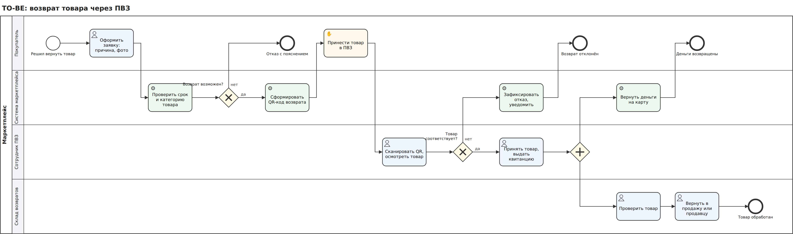
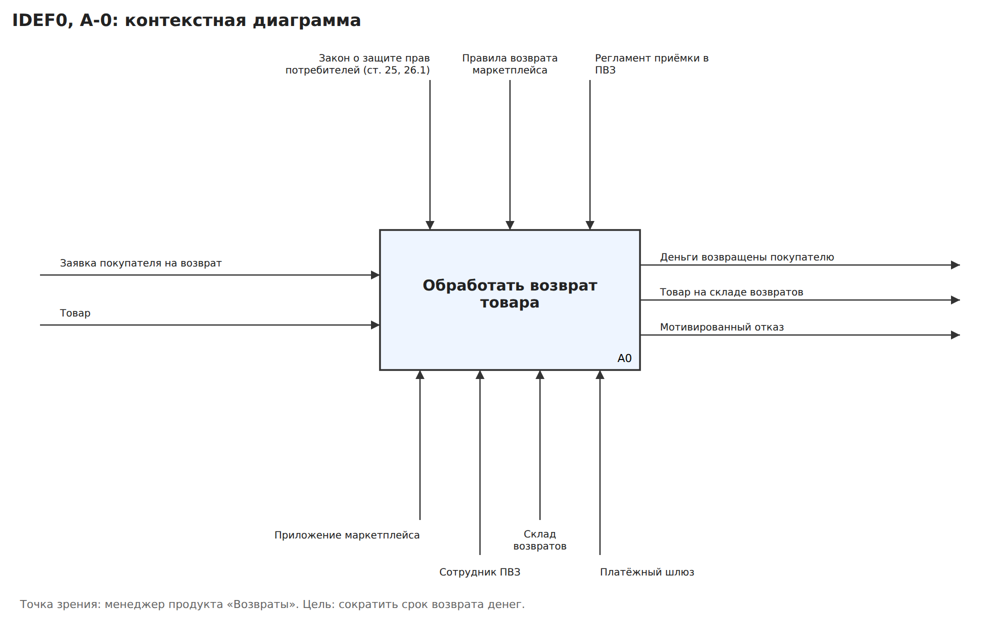
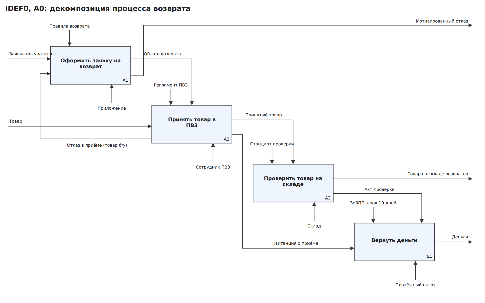
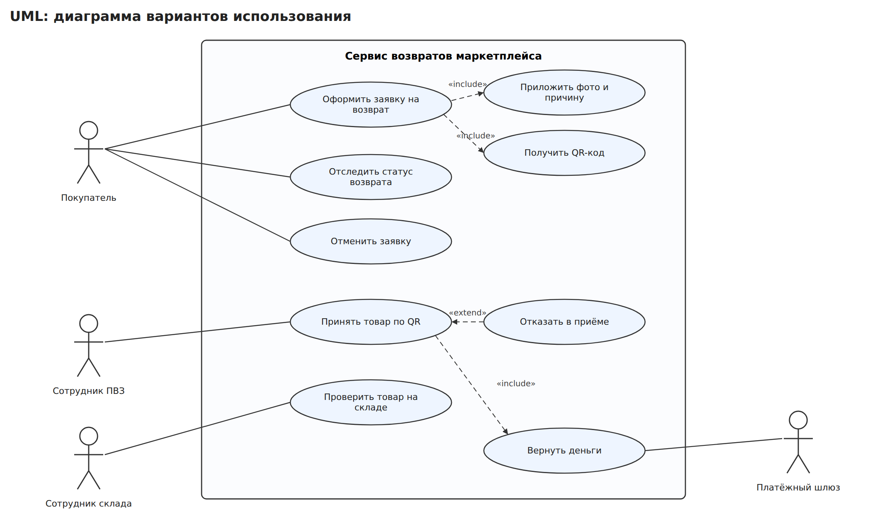

# Сервис возврата товаров через ПВЗ: требования и ТЗ

Кейс бизнес-аналитика: маркетплейс хочет ускорить возврат денег покупателям и разгрузить поддержку.
Я описала процесс в нотациях IDEF0, BPMN 2.0, UML и DFD, собрала требования и написала техническое задание
по структуре ГОСТ 34.602-2020.

> Кейс учебный: компания и цифры условные.

## Проблема (AS-IS)

Сейчас покупатель пишет в поддержку, ждёт одобрения заявки, затем несёт товар в ПВЗ. Деньги он получает
только после проверки товара на складе возвратов.

| Метрика | Сейчас | Цель |
|---|---|---|
| Срок от заявки до возврата денег (медиана) | 12 дней | ≤ 3 дней |
| Обращений в поддержку по возвратам | 18% всех обращений | ≤ 8% |
| Доля заявок, одобренных вручную | 100% | ≤ 15% (остальные автоматически) |
| Оценка процесса возврата покупателями | 3,1 из 5 | ≥ 4,2 |

Главные причины: каждую заявку вручную проверяет сотрудник поддержки; деньги ждут проверки на складе даже
для товаров, которые ПВЗ уже осмотрел; покупатель не видит статус возврата и пишет в поддержку.

## Решение (TO-BE)

- **Самообслуживание**: покупатель оформляет заявку в приложении, система сама проверяет срок и категорию товара.
- **QR-код** вместо бумажного заявления: сотрудник ПВЗ сканирует код и видит заявку.
- **Деньги после приёмки в ПВЗ**, а не после склада: для товаров без признаков использования риск низкий,
  спорные случаи разбираются со складом отдельно.
- **Статус возврата онлайн** с push-уведомлениями.

## Модели процесса

| IDEF0 A-0 | IDEF0 A0 |
|---|---|
|  |  |

## Артефакты

| Документ | Содержание |
|---|---|
| [`docs/01_requirements.md`](docs/01_requirements.md) | стейкхолдеры, бизнес-правила, функциональные и нефункциональные требования, user stories, описание use case |
| [`docs/02_TZ_GOST34.md`](docs/02_TZ_GOST34.md) | техническое задание по структуре ГОСТ 34.602-2020 (также в [.docx](docs/02_TZ_GOST34.docx)) |
| [`docs/03_data_and_api.md`](docs/03_data_and_api.md) | DFD, диаграмма последовательности, статусная модель, REST API |
| [`diagrams/01_to_be.bpmn`](diagrams/01_to_be.bpmn) | BPMN 2.0, открывается в [bpmn.io](https://demo.bpmn.io) и Camunda Modeler |

## Нотации и методы

IDEF0 · BPMN 2.0 · UML (use case, sequence, state) · DFD · ГОСТ 34.602-2020 · User Stories · MoSCoW · REST API
