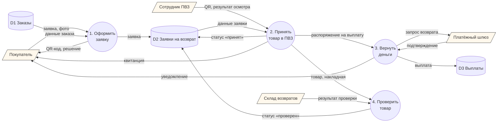
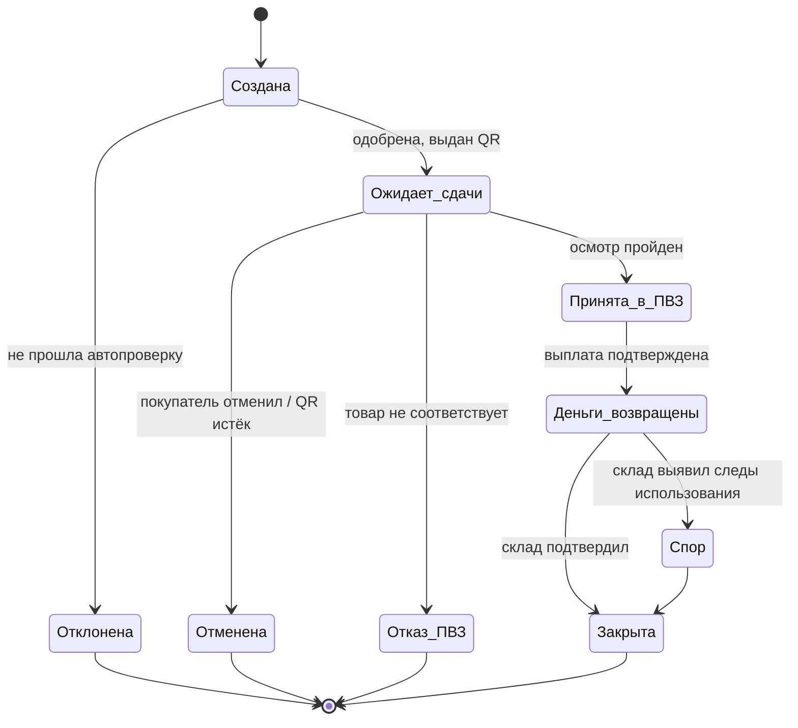
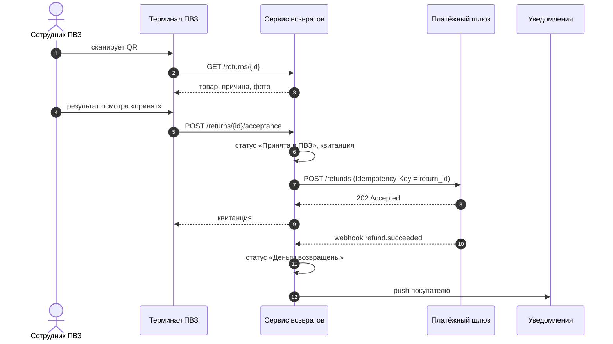
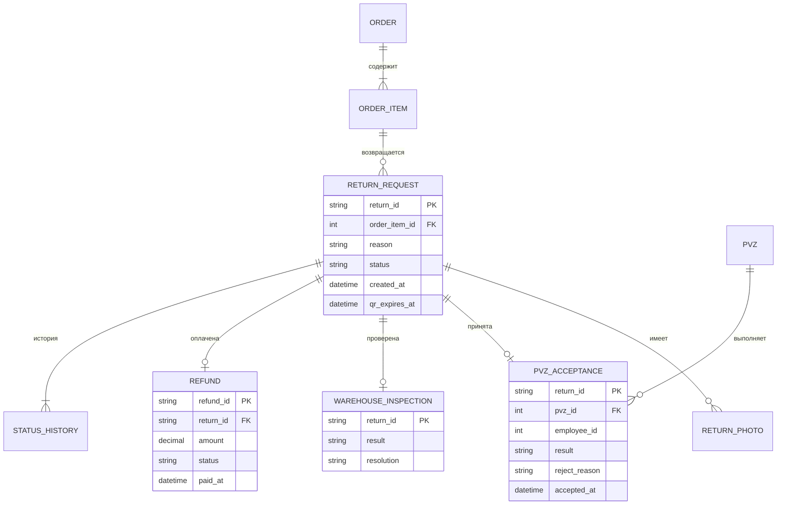

# 3. Данные, интеграции и API

## 3.1. DFD (уровень 0)



## 3.2. Статусная модель заявки



## 3.3. Приёмка в ПВЗ и выплата



## 3.4. REST API (основные методы)

| Метод | Путь | Назначение | Кто вызывает |
|---|---|---|---|
| POST | `/returns` | создать заявку, получить решение | приложение покупателя |
| GET | `/returns/{id}` | данные и статус заявки | приложение, терминал ПВЗ |
| DELETE | `/returns/{id}` | отменить заявку до сдачи | приложение покупателя |
| POST | `/returns/{id}/acceptance` | результат осмотра в ПВЗ | терминал ПВЗ |
| POST | `/returns/{id}/inspection` | результат проверки на складе | система склада |
| GET | `/sellers/{id}/returns/report` | отчёт продавцу | кабинет продавца |

**Пример: `POST /returns`**

```jsonc
// запрос
{
  "order_id": 900123,
  "item_id": 55,
  "reason": "not_as_described",
  "comment": "Цвет отличается от фото",
  "photos": ["ph_81f2", "ph_81f3"]
}
// ответ 201
{
  "return_id": "RET-2026-000481",
  "status": "awaiting_dropoff",
  "qr_code": "https://.../qr/RET-2026-000481",
  "qr_expires_at": "2026-10-07T23:59:59+03:00"
}
// ответ 422 — отказ по бизнес-правилу
{ "error": "return_period_expired", "message": "Срок возврата истёк 21.09.2026" }
```

## 3.5. Логическая модель данных


